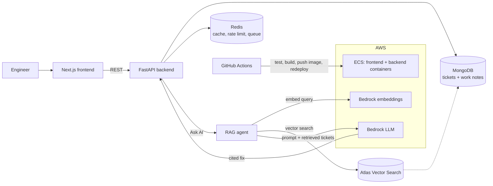

# Resolve AI

AI copilot for IT support tickets. Resolve AI is a ServiceNow-style ticket portal with a built-in AI agent: when an engineer clicks **Ask AI** on a ticket, the agent searches past resolved tickets and work notes with retrieval-augmented generation (RAG), then suggests resolution steps and cites the ticket numbers it used (for example, "based on INC0010042 and INC0010107").

> Status: early development. The project skeleton is in place. See the [roadmap](#roadmap).

## Why

Support teams fix the same problems again and again, and the answer is usually buried in an old ticket's work notes. Resolve AI surfaces that knowledge at the moment it's needed, and every suggestion links back to its source tickets, so engineers can check the fix instead of trusting it blindly.

## Architecture



**Request flow for "Ask AI":**

1. The frontend sends the ticket to the backend.
2. The backend embeds the ticket text with a Bedrock embedding model.
3. Atlas Vector Search returns the most similar resolved tickets and work notes.
4. Those tickets are passed to a Bedrock LLM, which writes suggested steps and cites the ticket numbers it used.
5. Results are cached in Redis so repeated questions are fast and cheap.

## Tech stack

| Layer | Choice | Why |
| --- | --- | --- |
| Frontend | Next.js (TypeScript, App Router) | Server rendering, typed UI, easy deploy as a container |
| Backend | FastAPI (Python) | Async, fast, automatic OpenAPI docs, Pydantic validation |
| Database | MongoDB + Atlas Vector Search | Tickets are documents; vectors live next to the data they describe |
| Cache / queue | Redis | Response caching, rate limiting, background jobs |
| AI | AWS Bedrock (LLM + embeddings) | Managed models, no GPU servers to run |
| Infra | Docker, AWS ECS | Same containers locally and in production |
| CI/CD | GitHub Actions | Lint and test on every PR; build, push and redeploy on main |

## Project structure

```
resolve-ai/
├── backend/              FastAPI service
│   ├── app/
│   │   ├── main.py       App factory, CORS, startup/shutdown
│   │   ├── config.py     Settings from environment variables
│   │   ├── db.py         MongoDB and Redis connections
│   │   ├── dependencies.py  Per-request dependencies (e.g. the ticket repository)
│   │   ├── models/       Pydantic models (Ticket, WorkNote, ...)
│   │   ├── repositories/ All MongoDB queries, one class per collection
│   │   └── routers/      API routes (health, tickets; later the agent)
│   └── tests/            pytest suite (runs against a real MongoDB)
├── frontend/             Next.js app
│   ├── app/              Pages (App Router): /tickets, /tickets/new, /tickets/[number]
│   └── lib/api.ts        Typed client for the backend (server-side only)
├── docker-compose.yml    Local stack: frontend, backend, mongo, redis
├── .env.example          Environment variables template
└── .github/workflows/    CI pipeline
```

## API

Interactive docs at http://localhost:8000/docs once the backend is running.

| Method | Path | What it does |
| --- | --- | --- |
| `POST` | `/tickets` | Open a ticket. Numbers are assigned in order: `INC0010001`, `INC0010002`, ... |
| `GET` | `/tickets` | List tickets, newest first. Filters: `status`, `priority`, `q` (text search). Paging: `limit`, `skip` |
| `GET` | `/tickets/{number}` | Get one ticket with its work notes |
| `PATCH` | `/tickets/{number}` | Change status, priority, assignment group, etc. Only the fields sent are changed |
| `POST` | `/tickets/{number}/work-notes` | Add a work note |
| `POST` | `/tickets/{number}/resolve` | Resolve with resolution notes (at least 10 characters) |
| `GET` | `/health`, `/health/ready` | Liveness, and readiness (MongoDB + Redis reachable) |

Rules: closed tickets are read-only (`409`), a ticket can only be resolved through `/resolve` so it always has resolution notes, and resolving twice returns `409`.

## Local setup

**Prerequisites:** Docker Desktop. For running services outside Docker you also need Python 3.12+ and Node.js 22+.

### Run everything with Docker

```bash
git clone https://github.com/PaswanRaju/resolve-ai.git
cd resolve-ai
cp .env.example .env
docker compose up --build
```

Then open:

- Frontend: http://localhost:3000 (shows live status of the API, MongoDB and Redis)
- API docs: http://localhost:8000/docs
- Health: http://localhost:8000/health and http://localhost:8000/health/ready

### Run the backend on its own

```bash
docker compose up -d mongo redis
cd backend
python -m venv .venv && source .venv/bin/activate
pip install -r requirements-dev.txt
uvicorn app.main:app --reload
```

Tests and lint (the ticket tests need MongoDB running, from `docker compose up -d mongo`):

```bash
pytest
ruff check . && ruff format --check .
```

### Run the frontend on its own

```bash
cd frontend
npm install
npm run dev
```

## Roadmap

- [x] **1. Skeleton:** monorepo, Docker Compose, health checks, ticket models, CI
- [x] **2. Ticket CRUD:** create, list, update and resolve tickets, with work notes
- [ ] **3. Synthetic data:** generate a realistic set of resolved IT tickets (no real company data)
- [ ] **4. Embeddings + vector search:** embed tickets with Bedrock, index in Atlas Vector Search
- [ ] **5. AI agent:** "Ask AI" endpoint and UI with cited suggestions
- [ ] **6. Evaluation:** measure retrieval quality and answer accuracy on a held-out set
- [ ] **7. Deploy:** AWS ECS with a GitHub Actions pipeline (test, build and push image, redeploy)
- [ ] **8. Experiment:** compare RAG against a fine-tuned model, with measured results

## Data

All ticket data is synthetic or from public datasets. No real employer or customer data is used.

## License

[MIT](LICENSE)
